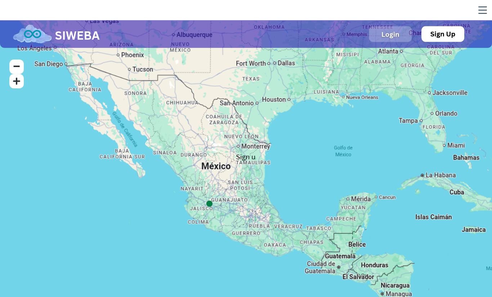
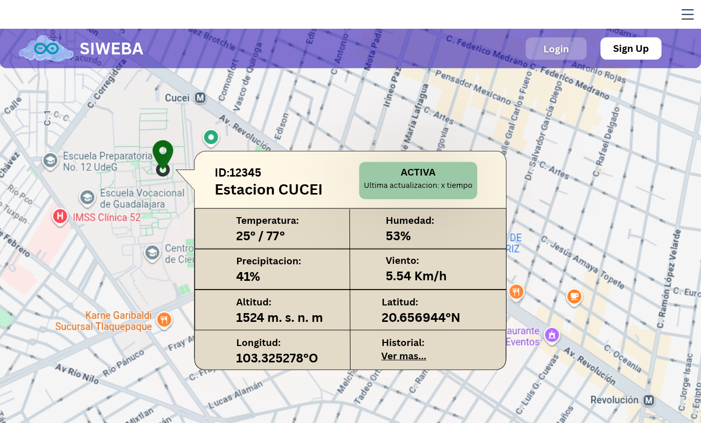
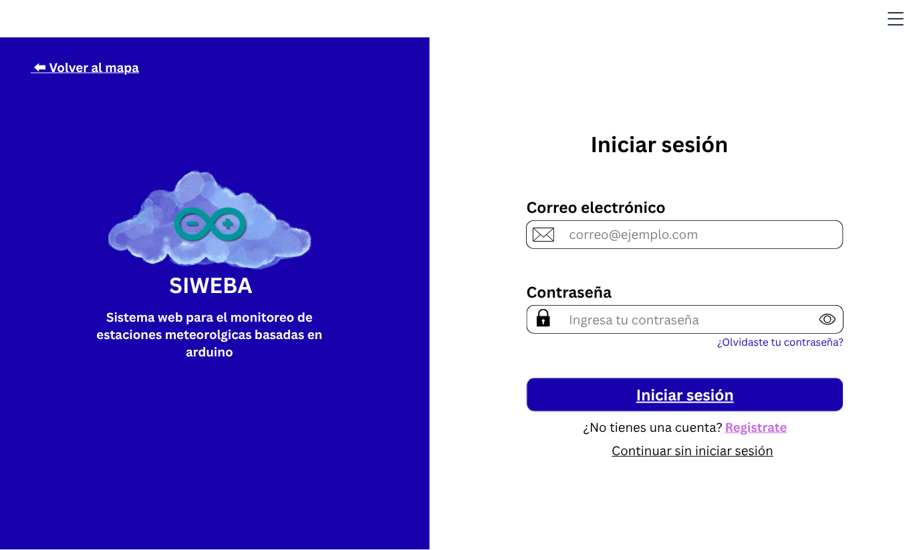
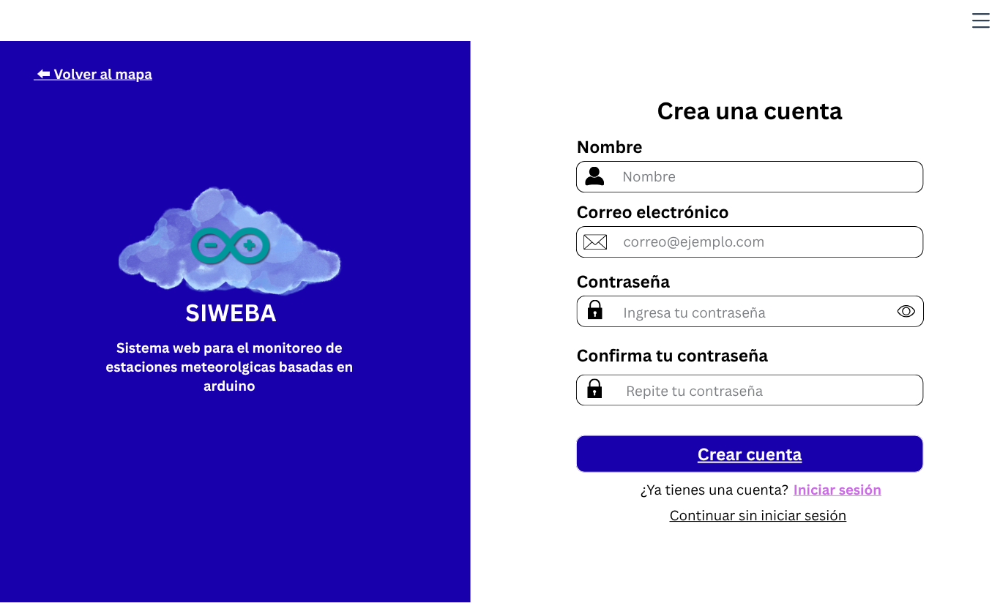
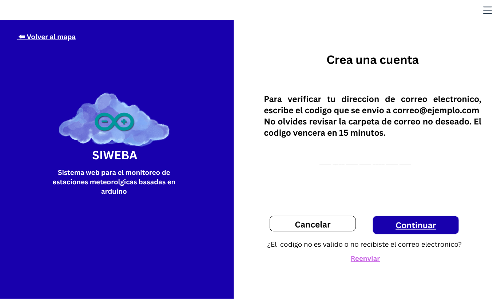

# Design Baseline v1.0 — SIWEBA

## Propósito

La Design Baseline es el punto de partida técnico recibido del Laboratorio Abierto: Diseño antes de la etapa de Construcción. Permite comparar el diseño inicial con las decisiones y modificaciones realizadas durante los sprints.

Esta línea base corresponde al proyecto SIWEBA completo: estación meteorológica, backend y frontend. No representa necesariamente el estado actual de construcción.

## Información general

| Campo | Información |
|---|---|
| Proyecto | Diseño e implementación de un sistema web para el monitoreo de estaciones meteorológicas basadas en Arduino. |
| Procedencia | Laboratorio Abierto: Diseño |
| Fecha de recepción | 16/10/2026 |
| Versión | Design Baseline v1.0 |
| Mentor | Dr. Juan José López Cisneros |
| Project Leader | Primitivo Oyoque Vargas |
| Estado del diseño | En progreso |
| Documentos recibidos | Inventario en revisión; consultar la tabla de materiales. |
| Pendientes conocidos | Pendiente de identificar y confirmar los aspectos que no estaban resueltos al recibir el diseño. |
| Restricciones conocidas | Pendiente de confirmar las restricciones que aplicaban al recibir el diseño. |

## Materiales de diseño

| Material | Ubicación | Estado de identificación |
|---|---|---|
| Modelo 3D del pluviómetro | [Pluviometro.stl](modelos-3d/Pluviometro.stl) | Presente en el repositorio; pendiente de confirmar si formaba parte del diseño recibido. |
| Capturas del prototipo de interfaz web | [interfaz-web/](interfaz-web/) | Referencias visuales del diseño; se describen a continuación. |

### Prototipo de interfaz web

Las capturas muestran la propuesta visual de la interfaz y sirven como referencia para comparar el diseño con la implementación. No acreditan que las funciones mostradas estén implementadas.

#### Vista inicial

Mapa principal con acceso al inicio de sesión y registro.

#### Detalles de estaciones

Información de una estación seleccionada en el mapa, incluidas sus mediciones y ubicación.

#### Iniciar sesión

Formulario de acceso y opción para continuar sin iniciar sesión.

#### Registro

Formulario de creación de cuenta.

#### Verificación de registro

Pantalla de verificación del correo electrónico mediante un código.

## Repositorios relacionados

- [documentacion](https://github.com/SIWEBA/documentacion): documentación general, gestión y seguimiento de los tres sprints.
- [django-backend](https://github.com/SIWEBA/django-backend): código y documentación técnica del backend.
- [django-frontend](https://github.com/SIWEBA/django-frontend): código del frontend.

## Versiones y seguimiento

La Design Baseline v1.0 identifica el diseño inicial; no cambia automáticamente al comenzar otro sprint. Corregir o completar este inventario durante el sprint II permite recuperar información faltante, pero no convierte los cambios de Construcción en parte del diseño recibido.

Si posteriormente se acuerda una revisión importante del diseño, se puede identificar una nueva versión de manera explícita, conservar la referencia a la anterior y documentar qué cambió y por qué. El manual no exige crear una v2 por cada sprint.

El seguimiento de Construcción se registra por separado:

- **Sprint I:** `sprint-1-plan-baseline-v1.0` identifica el plan entregado y no debe modificarse para incorporar avances posteriores.
- **Sprint II:** el Progress Review documentará avances, desviaciones, decisiones y cambios respecto del plan y del diseño inicial. Al finalizar, el manual permite identificarlo opcionalmente con `sprint-2-review-v1.0`.
- **Sprint III:** `construction-handover-v1.0` identificará el estado de construcción transferido a Pruebas.

La etiqueta `design-baseline-v1.0` identifica esta recopilación parcial del diseño inicial, documentada después de la entrega del sprint I. Los datos y materiales pendientes de confirmar permanecen señalados arriba; la etiqueta no implica que el estado actual de los tres repositorios corresponda al momento de recepción.
